<p align="center">
  
</p>

<h1 align="center">cogs</h1>

<p align="center"><b>An avatar studio for machines.</b><br/>Pick a chassis, tune the optics, set the mood, ship it as SVG.</p>

---

## What's inside

- **20 chassis.** Octa, Capsule, Tabbed, Hexa, Keyhole, Chamfer, Bloom, Plate, Sprocket, Orb, Keystone, Dome, Clamp, Bracket, Crest, Cross, Ticket, Rampart, Lynx and Fold. Each one is pure parametric SVG with a machined bevel, fasteners and a recessed visor. When the status light sits above the visor, it is cut into a notch of the visor recess.
- **12 expressions.** Idle, Happy, Sleepy, Angry, Sad, Surprised, Suspicious, Wink, Focused, Skeptic, Bored and Pondering. They're built from lids, tilts and cheek crescents over dot-matrix LED eyes and tween smoothly between states.
- **Alive by default.** The eyes follow your cursor, glance around when idle and blink on their own schedule.
- **8 display modes.** Eyes, Voice (waveform), Typing (dots), Glyph (pixel robot), and four agent states: Thinking (chasing LED ring), Search (radar sweep), Coding (scrolling terminal) and Working (a train of meshing LED gears). The agent states animate with SVG SMIL, so exported SVGs keep moving.
- **Power bars.** Core charge (glow), Curiosity (gaze) and Blink rate.
- **Export and share.** SVG and PNG at 1024px, plus a share link that stores the cog in the URL hash.
- **JSON in and out.** Copy, download, edit, paste or upload JSON to rebuild a cog. Pasting cog JSON anywhere on the page builds it.
- **Docs and changelog.** `/docs` is the manual, with ⌘K search and live chassis and expression galleries. `/changelog` lists every release.
- **Components.** `/components` has drop-in pieces for apps with a cog in them: CogComposer (a machined chat console with the bot perched in a cradle and a voice-reactive LED channel), CogRing (a machined voice ring), CogAvatar with presence, CogTyping, CogBelt (Sprocket units chained by coloured timing belts), a gear loader and a task card.
- **Self-assembling roster.** Roster units draft themselves in blueprint lines, then get paint, fasteners, a visor and power as they scroll into view.
- **The assembly line.** In the footer, a meshing gear train drives a conveyor, and units ride through a QA scanner while Flange supervises.

## Cog JSON

```json
{
  "$schema": "cogs/unit@1",
  "name": "Flange",
  "chassis": "gear",
  "color": "#e8603f",
  "glow": "#ffb23f",
  "expression": "angry",
  "screen": "eyes",
  "optics": "auto",
  "pupils": false,
  "charge": 0.78,
  "curiosity": 0.7,
  "blink": 0.5
}
```

| Field | Values |
| --- | --- |
| `chassis` | `octa` `capsule` `tab` `hex` `drop` `chamfer` `bloom` `plate` `gear` `orb` `keystone` `dome` `clamp` `bracket` `crest` `cross` `ticket` `rampart` `lynx` `fold` |
| `expression` | `idle` `happy` `sleepy` `angry` `sad` `surprised` `suspicious` `wink` `focused` `skeptic` `bored` `lookup` |
| `screen` | `eyes` `wave` `dots` `glyph` `think` `search` `code` `work` |
| `optics` | `auto` `mono` `dual` |
| `color`, `glow` | `#rrggbb` |
| `charge`, `curiosity`, `blink` | `0` – `1` |

Every field is optional. Missing or invalid values fall back to the defaults, and the studio reports a warning for each one.

## Develop

Uses [Bun](https://bun.sh). `app/bunfig.toml` runs package scripts on the Bun runtime, so Node isn't required.

```sh
cd app
bun install
bun run dev      # http://localhost:5173
bun run build    # type-check + production build
bun run logo     # re-render public/logo.svg from the LOGO config
```

Keyboard shortcuts: `R` randomizes, `←` / `→` cycle expressions, and `⌘↵` builds from the JSON editor.

## Where things live

```
app/src/
  components/Cog.tsx        the avatar: body, recess, light, visor + animation loop
  components/Eyes.tsx       LED eye renderer (lids, cheeks, pupils, display modes)
  components/Stage.tsx      blueprint preview with dimension callouts
  components/JsonPanel.tsx  JSON source editor
  lib/chassis.ts            chassis geometry; add a shape here
  lib/expressions.ts        expression parameters; add a mood here
  components/Gearworks.tsx  the footer assembly line (meshing gear train + conveyor)
  components/SiteChrome.tsx shared nav and footer
  docs/                     /docs: shell, search, ruler rail and page content
  kit/                      /components: CogKit.tsx (the components), the page, and archive/ for retired parts
  changelog/Changelog.tsx   /changelog: add new releases at the top of ENTRIES
  lib/config.ts             config model, presets, names, JSON validation
  lib/router.ts             tiny History API router: /, /docs, /docs/:page, /components, /changelog
```

The app uses clean routes with no `.html`. The dev server falls back to `index.html`, and `vercel.json` does the same on Vercel. The root `vercel.json` builds `app/`, so the project deploys whether its Root Directory is the repo root or `app`. On any other host, add an SPA fallback to `index.html`.

## Credits

Built by [404khai](https://404khai.vercel.app).

Type: [Allo](https://allo.joshpuckett.me) by Josh Puckett (OFL) and JetBrains Mono. Bot styling is inspired by [Devin's bots](https://devin.ai/bots).
